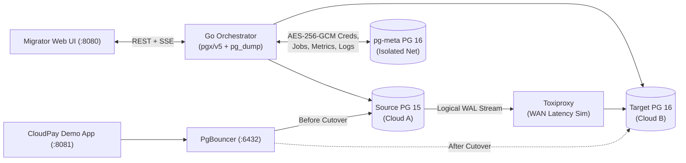

# PG Zero-Downtime Cross-Cloud Migrator

A self-hosted web tool + Docker Lab for **zero-downtime PostgreSQL migrations across clouds** (e.g., AWS RDS ↔ GCP Cloud SQL ↔ Azure ↔ Self-Hosted) and **major version upgrades** (e.g., PG 15 → PG 16) using **PostgreSQL Native Logical Replication**.

All migration state, encrypted credentials, audit logs, and real-time replication metrics are stored in **PostgreSQL (`pg-meta`)**.

---

## How It Works (Architecture)



### Why Native Logical Replication?
Managed cloud databases do not give filesystem/superuser access for physical streaming replication across different cloud providers or major versions. Logical Replication works across clouds and major versions — and this tool automates the hard parts PostgreSQL does **not** handle automatically:

1. **Pre-flight Validation** — Checks `wal_level = logical`, replication slot/worker capacity, extensions parity, and detects tables missing a Primary Key (with 1-click `REPLICA IDENTITY FULL` fix).
2. **Cloud-Safe Schema Sync & Foreign Key Deferral** — Runs `pg_dump --schema-only --no-owner --no-privileges`, strips cloud-specific artifacts (`rdsadmin`, `cloudsqlsuperuser`, `azure_pg_admin`, cross-version `SET` directives), and separates `FOREIGN KEY` constraints so parallel initial table copies never fail on FK ordering. Deferred FKs are applied online (`NOT VALID` → `VALIDATE CONSTRAINT`) before cutover.
3. **Live Monitoring & WAL Guardrail** — Tracks per-table sync state (`i` → `d` → `f` → `s` → `r`), replication lag (bytes), and WAL retained on Source with an alert threshold so Source disk never fills up unexpectedly.
4. **Data & Sequence Drift Verification** — Runs parallel exact row counts, PK-ordered sample MD5 checksums, and displays `BIGSERIAL`/`IDENTITY` sequence drift.
5. **Guided Zero-Downtime Cutover** — Pauses PgBouncer (queues live queries cleanly without dropping connections), optionally freezes Source writes, drains WAL lag to `0 bytes`, **synchronizes all Sequences**, tears down subscription/publication/slot cleanly, switches PgBouncer to Target, and resumes traffic. If anything fails mid-flight, Source read-only and PgBouncer pause are rolled back automatically.

---

## Quick Start (Docker Lab)

### Prerequisites
- Docker Desktop / **OrbStack** (macOS) with `docker compose`
- `make` and `openssl`

### 1. Start the full stack
```bash
cd pg-migrator
make up
```
This automatically generates cryptographic random passwords into `.env` (`chmod 600`) and starts all services:

| Service | URL / Role |
| :--- | :--- |
| **Migrator Web UI** | http://127.0.0.1:8080 |
| **CloudPay Demo App** | http://127.0.0.1:8081 (live ~10 TPS inserts/updates/deletes via PgBouncer) |
| **`pg-meta`** | PostgreSQL 16.4 — state, logs, metrics, AES-256-GCM encrypted credentials |
| **`pg-source`** | PostgreSQL 15.8 — simulates Cloud A (`wal_level=logical`) |
| **`pg-target`** | PostgreSQL 16.4 — simulates Cloud B (PG 15 → PG 16 upgrade) |
| **`pgbouncer`** | Connection pooler enabling zero-drop `PAUSE → SWITCH → RESUME` cutover |
| **`toxiproxy`** | Simulates cross-cloud WAN latency (35ms / 80ms / 200ms) or network drops |

### 2. (Optional) Load the ~10 GiB TPC-H Benchmark Dataset
You can test with just the live `live_transactions` table, or seed the industry-standard **TPC-H** relational dataset locally using DuckDB (no 10 GB download required):

```bash
# Quick test (~1.3 GiB, ~15 seconds)
make seed-1g

# Full stress test (~10–14 GiB in PostgreSQL, ~2–4 minutes)
make seed-10g
```

---

## Side-by-Side Live Migration Walkthrough

Open two browser windows side by side:
- **Left**: http://127.0.0.1:8081 (**CloudPay Demo App**) — watch live writes going to `CLOUD A • sourcedb (PG 15.8)`.
- **Right**: http://127.0.0.1:8080 (**PG Migrator UI**).

Follow the 5 steps in the Migrator UI:

1. **Create Job**: Click **`+ New Migration Job`** → click **`Quick Fill Docker Lab (PG 15 → PG 16)`** → **`Save to pg-meta`**.
2. **Step 1 — Pre-flight Check**: Click **`Run Pre-flight Check`** and confirm all checks are green.
3. **Step 2 — Schema Sync**: Click **`Dump & Apply Schema to Target`** (copies tables, PKs, sequences, indexes; defers FKs).
4. **Step 3 — Initial Sync & CDC**: Click **`Start Initial Sync + CDC`**.
   - Watch the real-time Lag & WAL Retained chart and per-table progress until every table reaches **`r — Streaming (Ready)`**.
   - *(Optional)* Test cross-cloud network instability using the **Toxiproxy** buttons (`35ms WAN`, `80ms WAN`, or `Cut Link` → restore) and watch WAL retained rise and then drain back to `0 B`.
5. **Step 4 — Verify**: Click **`Run Verify Now`** to compare Source vs Target row counts and inspect **Sequence Drift** on `live_transactions_tx_id_seq`.
6. **Step 5 — Guided Cutover**: Keep PgBouncer / Read-Only / Deferred FKs checked and click **`Execute Zero-Downtime Cutover`**.
   - Watch the **CloudPay Demo App (`:8081`)** flip live from blue **`sourcedb (PG 15.8)`** to green **`targetdb (PG 16.4)`** with **`0` failed requests** and continuous `tx_id` numbers!
   - Click **`Verify No Lost Writes`** in `:8081` to confirm 100% of the last 200 acknowledged transactions exist on `targetdb` (`0 missing`).

### Re-running a Clean Test
```bash
make reset
```
Takes ~2 seconds: clears old jobs from `pg-meta`, drops replication objects, wipes `pg-target`, resets Toxiproxy to `0ms`, switches PgBouncer back to `pg-source`, and resets Demo App counters — **while keeping your seeded ~10 GiB TPC-H data on `pg-source`** so you don't have to re-seed.

---

## Using for Real Cross-Cloud Migrations

When migrating real databases (AWS RDS, GCP Cloud SQL, Azure Flexible Server, or self-hosted):

1. **Enable Logical Replication on Source**:
   - **AWS RDS / Aurora**: Set parameter group `rds.logical_replication = 1` (requires reboot).
   - **GCP Cloud SQL**: Set database flag `cloudsql.logical_decoding = on` (requires restart).
   - **Azure Flexible Server**: Set server parameter `azure.logical_decoding = on` / `wal_level = logical`.
2. **Network & SSL**:
   - Set **SSL Mode** to `require` or `verify-full`.
   - If the migrator connects via a bastion/public endpoint while Target connects to Source via PrivateLink/VPC Peering, fill in **Replication Host / Port** separately in the Create Job modal.
3. **Cutover without Lab PgBouncer**:
   - Uncheck **"Use PgBouncer"** in Step 5.
   - Use **"Set Source Read-Only"** (or pause your own production PgBouncer/app), let the tool drain WAL to `0` and sync all sequences, then update your production DNS / connection string to Target.
4. **Network Egress Note**:
   - In `docker-compose.yml`, `migration-net` is `internal: true` for Docker Lab security (zero internet egress). To reach external cloud databases from the `backend` container, attach `backend` to a network with outbound access (or run the Go binary directly inside your migration VPC/bastion).

---

## Command Reference

| Command | Description |
| :--- | :--- |
| `make up` | Generate `.env` (if missing), build images, and start the entire stack |
| `make seed-1g` | Generate & load ~1.3 GiB TPC-H dataset into `pg-source` (~15s) |
| `make seed-10g` | Generate & load ~10–14 GiB TPC-H dataset into `pg-source` (~2–4m) |
| `make reset` | Fast 2s full reset (`pg-meta`, `pg-target`, PgBouncer, Toxiproxy, Demo App) while preserving seeded data on `pg-source` |
| `make logs` | Stream live logs from `backend`, `pgbouncer`, and `workload-sim` |
| `make audit-supply-chain` | Inspect direct dependencies and Docker image SHA256 digests |
| `make down` | Stop containers (preserves volumes/data) |
| `make clean` | Stop containers and delete **all** Docker volumes (complete wipe) |

---

## Security & Supply-Chain Protection

This project was designed with strict supply-chain and runtime hardening — see [SECURITY.md](./SECURITY.md) for full details:
- **Minimal dependencies**: 1 direct Go dependency (`pgx/v5`), 28 total frontend npm packages (`0 vulnerabilities` on `npm audit`, `ignore-scripts=true`, lockfile-verified `npm ci`), binary-only pinned Python wheels (`--only-binary=:all:`).
- **Zero-egress database networks**: `meta-net` and `migration-net` are Docker `internal: true` networks; Web UIs bind strictly to `127.0.0.1`.
- **Encrypted secrets & least privilege**: Random `.env` (`chmod 600`), AES-256-GCM encryption for DB passwords in `pg-meta`, `scram-sha-256` auth, `NOSUPERUSER` migration roles (`pg_create_subscription` + `pg_monitor`), and non-root containers with `cap_drop: [ALL]`.

---

## Troubleshooting

- **Cutover fails with `subscription ... is missing or has 0 tables`**: Target has no active subscription (e.g., after `make reset`). Run Steps 1 → 2 → 3 on a fresh job before Step 5.
- **Docker build times out reaching Docker Hub / Go proxy**: Ensure your Docker runtime VM has working internet egress (on macOS, **OrbStack** is recommended over Colima).
- **Port `8080` or `8081` already in use**: Override `WEB_PORT` or `DEMO_APP_PORT` in `.env` and run `docker compose up -d`.
